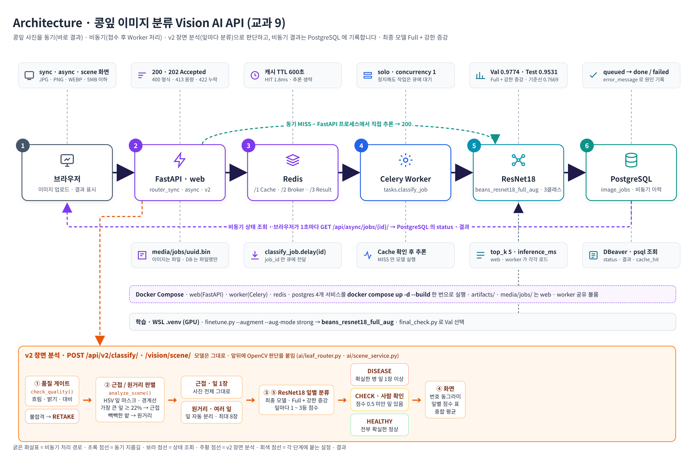

# yolo-baby-care-action-project — 바른품 보모·아기 돌봄 상황 인식 AI

## 프로젝트 소개

### Architecture

웹캠 Frame은 **항상 Detection**(adult · baby)과 ByteTrack으로 위치만 가볍게 봅니다. 보모와 아기가 **함께 있을 때만** Pose를 켜서 손 ↔ 아기 거리 같은 상호작용 Feature로 감시하고, **Event**(급하강 · 멀어짐 · 흔들림)가 생기면 버퍼에 쌓아 둔 Frame부터 Sequence로 상황을 분류합니다. Event가 끝나면 2단계 → 1단계로 돌아갑니다.

> 설계 v1 · 구현 진행 중 · 단계 전환 숫자 기준(BBox 겹침 비율 · 급하강 속도 · 거리)은 촬영 데이터로 정할 예정입니다.
